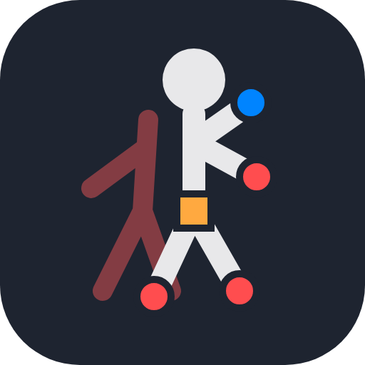
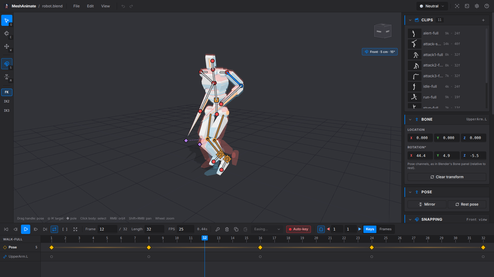
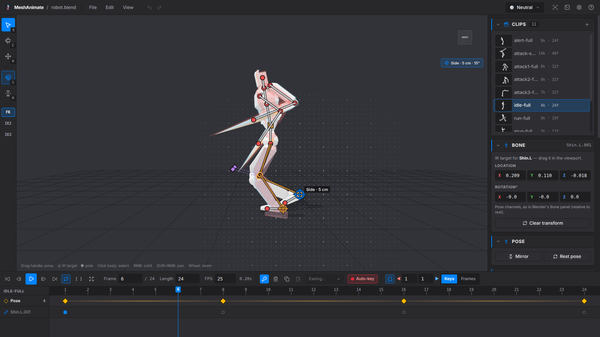
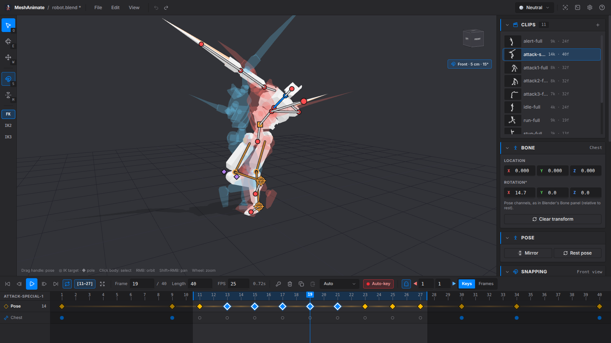
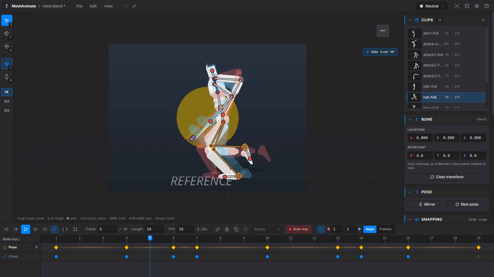

<p align="center">
  
</p>

<h1 align="center">MeshAnimate</h1>

<p align="center">
  <strong>Pivot-style pose-to-pose animation for rigged Blender characters.</strong>
</p>

<p align="center">
  <a href="https://github.com/stuyk/meshanimate/releases">
    
  </a>
  <a href="LICENSE">
    
  </a>
</p>

Open a `.blend`, grab a bone by its handle and drag it where it should go. Move to another frame, pose again. MeshAnimate keys whole poses on a single clear timeline, shows the poses before and after as onion-skin ghosts, and writes everything back into your `.blend` as ordinary Blender actions, NLA tracks included.

<p align="center">
  
  
</p>
<p align="center">
  
  
</p>

## What it does

- **Grab and pose.** Every bone has a handle at its tip: drag it and the bone swings, like Pivot Stickfigure Animator. The orange square moves the whole rig.
- **Uses your rig's IK.** Limbs driven by Blender IK constraints are posed by dragging the foot or hand; poles aim the knee and elbow. The preview matches Blender's solver to within half a degree.
- **Onion skin.** Ghosts of the previous and next poses (or every Nth frame) in two colours you choose, plus an optional pinned ghost of the first frame so the starting pose is always in view.
- **A timeline you can read.** One row of pose keys, one row showing where the selected bone actually moves. Drag to retime, Alt+drag to copy, box-select, right-click for easing, and set a preview range to loop just the part you're polishing.
- **Snapping.** From a side, front or top view, handles land on a grid and bones swing in clean angle steps, in Blender units.
- **Walk-cycle helpers.** Mirror a pose left ↔ right, or key its mirror half a cycle later with one key press.
- **Reference images and video** behind the model; video follows the playhead frame by frame.
- **Plays exactly like Blender.** Untouched actions preview Blender's own evaluation; edited ones use the same Bézier, easing and quaternion maths, verified against Blender in the test suite.

## Your .blend stays yours

- The file is copied to `.meshanimate-backups/` next to it before every save (newest 20 kept).
- Only actions you changed are rewritten, and within them only the bones you touched. Everything else in the file is left exactly as it was.
- New actions get a fake user and their own NLA track; renamed clips rename their track.
- If you save the same file from Blender while it's open here, MeshAnimate notices. It reloads by itself when you have no unsaved work, and otherwise offers to merge.

## Requirements

- [Blender](https://www.blender.org/download/) installed — tested with 5.2; the scripts also handle the older 4.x animation API but that hasn't been tested yet. MeshAnimate uses Blender in the background to read and write `.blend` files and finds it automatically (or point it there under Preferences).
- A `.blend` with an armature. Skinned meshes and rigid parts parented to bones both work.

Rigs that drive their mesh through other constraints (Rigify's Copy Transforms, Stretch To and drivers, for example) can be animated and saved, but the viewport preview is only approximate for them; MeshAnimate says so when it opens one.

## Keys worth knowing

| Key | Action |
| --- | --- |
| Space | Play / pause |
| ← / → · Shift+← / → | Previous / next frame · key |
| K | Key the current pose |
| M · Shift+M | Mirror pose · mirror to half-cycle |
| S | Snapping on / off (hold Ctrl to flip it for one drag) |
| Num 1 / 3 / 7 | Front / side / top view (Ctrl: opposite side) |
| [ · ] · \\ | Preview range start · end · clear |
| Q / E / W | Pose handles / rotate gizmo / move gizmo |
| O · Shift+O | Onion skin · first-frame ghost |
| Ctrl+S | Save into the .blend |

Press `?` in the app for the full list.

## Building from source

```bash
bun install        # or npm install
bun run dev        # run with hot reload
bun run test       # unit tests, including Blender parity fixtures
bun run build:linux   # or build:win / build:mac
```

Electron + Solid + three.js. The Blender side lives in `resources/blender/` (one script reads a `.blend`, one writes actions back); the rest is under `src/`.

## License

GPL-3.0-or-later. See [LICENSE](LICENSE).
